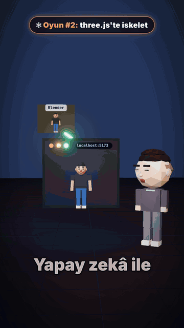
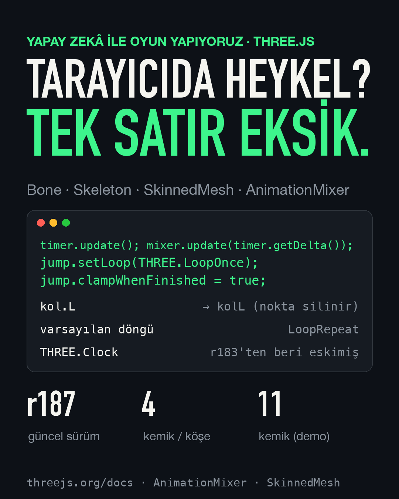

# Blender'da zıplayan karakter tarayıcıda heykel gibi mi duruyor? Çoğu zaman tek bir satır eksik.

Yapay zekâ ile oyun yapıyoruz, 2. bölüm: Blender'dan gelen karakteri tarayıcıda oynatmak.

Ajanın yazdığı kodda karakter yükleniyor ama kıpırdamıyor. Üç tuzak:
→ Kemiği adıyla arıyorsun, boş dönüyor: GLTFLoader adları PropertyBinding.sanitizeNodeName ile temizliyor, nokta siliniyor (kol.L → kolL).
→ Zıplama hiç bitmiyor: AnimationAction varsayılanı LoopRepeat.
→ Konsolda uyarı: THREE.Clock r183'ten beri eskimiş, yerine THREE.Timer.

Dört parça:
1. Bone: kemikler add ile zincir olur (omuz → dirsek → bilek), new THREE.Skeleton(bones).
2. SkinnedMesh: geometride skinIndex ve skinWeight öznitelikleri, köşe başına en çok 4 kemik; mesh.bind(skeleton).
3. GLTFLoader: Blender'dan gelen GLB'de hepsi hazır; gltf.scene + gltf.animations (AnimationClip dizisi).
4. AnimationMixer: mixer.clipAction(AnimationClip.findByName(gltf.animations, 'jump')), her karede timer.update(); mixer.update(timer.getDelta()).

Zıplama tek sefer: jump.setLoop(THREE.LoopOnce); jump.clampWhenFinished = true; jump.play();

**📊 Rakamlarla:**
• r187 güncel sürüm
• 4 kemik / köşe
• 11 kemik (demo)

**⚙️ Nasıl başlarsın:**
timer.update(); mixer.update(timer.getDelta());
jump.setLoop(THREE.LoopOnce);
jump.clampWhenFinished = true;

**📌 Kısa notlar:**
• kol.L: → kolL (nokta silinir)
• varsayılan döngü: LoopRepeat
• THREE.Clock: r183'ten beri eskimiş

Kaynaklar:
threejs.org/docs/pages/SkinnedMesh.html · Skeleton.html · Bone.html · AnimationMixer.html · AnimationAction.html
threejs.org/docs/pages/AnimationClip.html · GLTFLoader.html · PropertyBinding.html · Clock.html · Timer.html
docs.blender.org/manual/en/latest/animation/armatures/bones/editing/naming.html

three.js'te animasyonu elle mi kuruyorsunuz, glTF'ten mi alıyorsunuz?

[▶ Tam kalite video: video.mp4](video.mp4)

## Videoda adım adım

1. three.js'te bunun dört parçası var, kemik, iskelet, deri giymiş örgü ve animasyon karıştırıcısı.
2. Kemikleri baba oğul diye birbirine takıyorsun, omuz dirseği, dirsek bileği taşıyor.
3. Kodla yaptığın örgüde her köşe en fazla dört kemiğe bağlanıyor, kemiği ve ağırlığı iki listeyle yazıyorsun.
4. Blender'dan gelen dosyada bunların hepsi hazır, yükleyici karakteri ve kliplerini birlikte veriyor.
5. Karıştırıcıya zıplama klibini veriyorsun, her karede yeni zamanlayıcıdan geçen süreyi ona söylüyorsun.
6. Klibi tek sefere ayarlayıp son karede tutunca karakter bir kez zıplıyor ve yere iniyor.
7. Bu bilgisayardaki three.js kopyasında kol nokta L adı gerçekten noktasız kol L oluyor.
8. Blender'da kemik adlarında nokta yerine alt çizgi kullanıyorsun, sağ sol eşlemesi yine çalışıyor.
9. Aynı karakteri bu bilgisayarda tarayıcıda oynattık, kod satırlarını da three.js belgeleriyle tek tek karşılaştırdım.

## Lisans

Bu depodaki video, kart ve metinler MIT lisanslıdır (LICENSE). Anlatılan aracın kendi lisansı kendi deposundadır.
